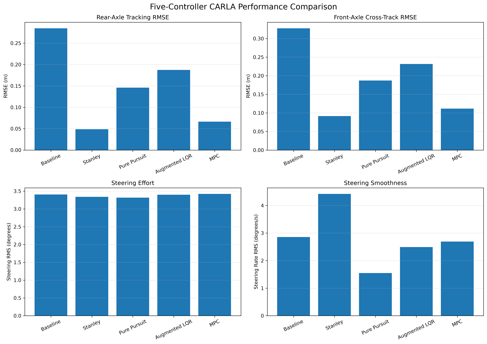
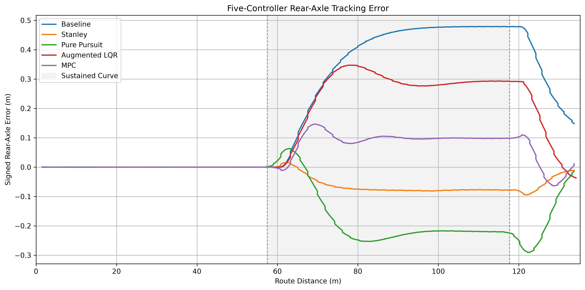
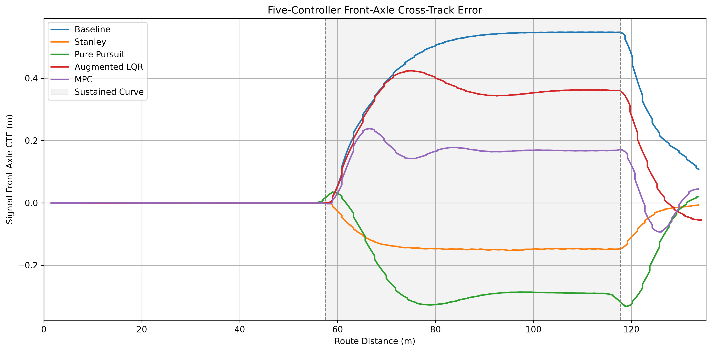
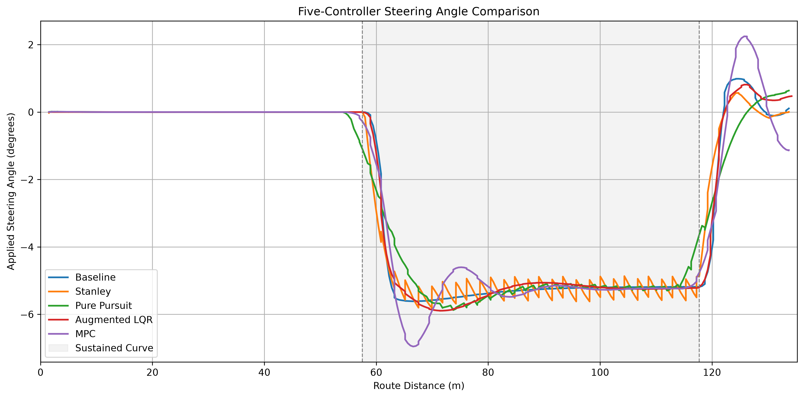
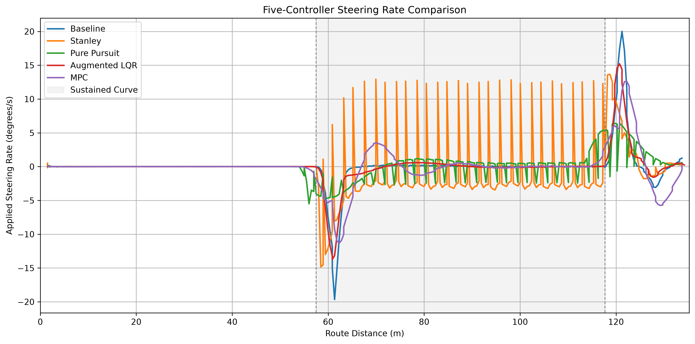
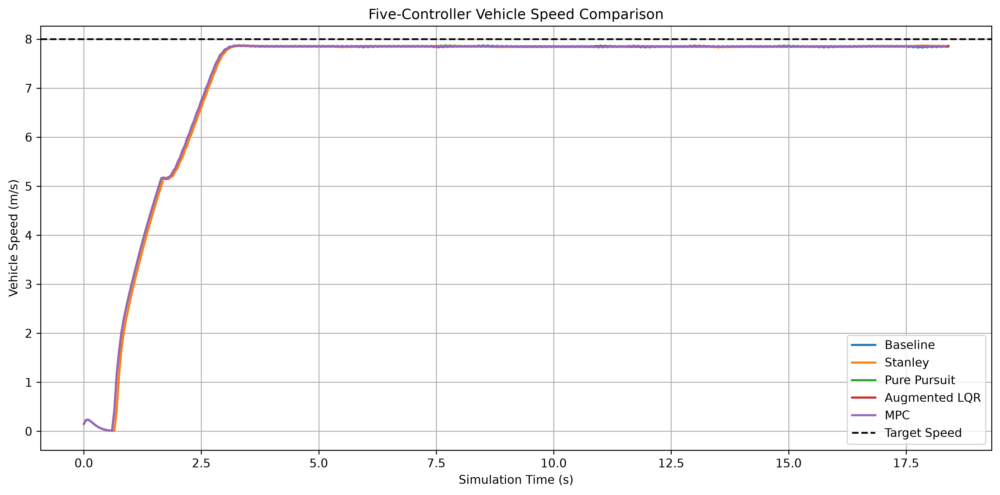

# Autonomous Vehicle Lane-Keeping: Controller Design and CARLA Validation

**Python · CARLA 0.9.16 · Stanley · Pure Pursuit · LQR · MPC · pytest**

A modular lateral path-tracking project that progresses from a kinematic bicycle model to closed-loop controller evaluation in CARLA. Five controller configurations were tested on the same 135.24 m route with steering-angle and steering-rate constraints.

> **Scope:** Simulation-based lateral control research and validation, not a production autonomous-driving or safety-certified system. Reported measurements are from the project's executed simulations and GitHub Copilot summaries; the benchmark has not yet been independently audited from raw telemetry in this README.

## At a glance

- **Five CARLA-tested controllers:** baseline proportional lateral + heading feedback with curvature feedforward, Stanley, Pure Pursuit, augmented LQR, and constrained MPC.
- **CARLA vehicle:** Tesla Model 3, Town10HD_Opt; physics-derived wheelbase approximately **3.0046 m**.
- **Common test:** 135.24 m route, **8 m/s target speed**, **0.05 s** synchronous timestep, steering angle **±30°**, steering rate **±20°/s**.
- **Reported outcome:** all five completed the route, with **zero detected collisions** and **zero reported steering-constraint violations**.
- **Automated tests:** **257 passed** in the most recent reported full suite.



## CARLA benchmark results

**Scenario:** `Town10HD_Opt`, Tesla Model 3, spawn point 61, continuous lane across roads 10 → 0 → 3. The 135.24 m route comprises a 57.50 m straight approach, a 60.22 m approximately 90° right-hand curve (radius approximately 37.66 m), and a 17.51 m straight exit. Target speed is 8 m/s; initial conditions, longitudinal controller, steering constraints, and route are intended to be shared across runs.

| Controller | Rear-axle RMSE (m) ↓ | Front-axle CTE RMSE (m) ↓ | Steering RMS (°) ↓ | Steering-rate RMS (°/s) ↓ | Completed | Collisions |
|---|---:|---:|---:|---:|:---:|---:|
| Stanley | **0.0488** | **0.0915** | 3.3415 | 4.4192 | Yes | 0 |
| Constrained MPC | 0.0664 | 0.1116 | 3.4207 | 2.6930 | Yes | 0 |
| Pure Pursuit | 0.1460 | 0.1871 | **3.3156** | **1.5476** | Yes | 0 |
| Augmented LQR | 0.1873 | 0.2315 | 3.3987 | 2.4933 | Yes | 0 |
| Baseline feedback + feedforward | 0.2847 | 0.3276 | 3.4049 | 2.8547 | Yes | 0 |

**Interpretation:** Stanley had the lowest reported tracking error in this scenario; Pure Pursuit had the lowest steering-rate RMS; MPC provided the second-lowest tracking error with a smoother steering-rate profile than Stanley. These are **scenario-specific findings**, not universal controller rankings. Baseline and augmented LQR gains were not comprehensively retuned for CARLA. The baseline is proportional lateral feedback with heading feedback (its integral and derivative gains are zero), not a fully tuned three-term PID.

### Route-history comparisons











### MPC timing on the CARLA test

- Prediction horizon: **15 steps × 0.05 s = 0.75 s**.
- Mean / maximum reported OSQP solve time: **0.2091 / 0.6578 ms**.
- Mean / maximum total controller computation time: **4.0738 / 11.4903 ms**.
- Reported solver failures, fallbacks, and observed 50 ms controller deadline misses: **0** over 368 steps.

These desktop measurements are not hard real-time guarantees.

## Architecture

```text
CARLA map waypoints ──> route profile / curvature ─────┐
                                                       v
CARLA Tesla ──> transforms / velocity ──> CARLA adapter ──> tracking state
    ^                                                       |
    |                                                       v
    |                                         controller selection:
    |                                    Baseline | Stanley | Pure Pursuit
    |                                         Augmented LQR | MPC
    |                                                       |
    └──── throttle / brake + normalized steering <──────────┘
                  |
                  v
           telemetry, metrics, tests, plots
```

The `CarlaControllerAdapter` converts CARLA's right-positive lateral / clockwise-positive yaw convention to the controller's left-positive lateral / counterclockwise-positive convention. It also uses wheel positions from live vehicle physics to locate the rear axle and converts controller steering angles to normalized CARLA commands with the required sign reversal. The Tesla's reported front-wheel maximum is 70°; the normalized mapping is nominal and CARLA's speed-dependent steering curve can alter effective response.

## Models and controllers

### Vehicle and road model

The offline kinematic bicycle model uses rear-axle position $(x,y)$, heading $\psi$, wheelbase $L=2.8\,\mathrm{m}$, speed $v$, and front-wheel steering $\delta$:

$$
\dot x=v\cos\psi,\qquad \dot y=v\sin\psi,\qquad
\dot\psi=\frac{v}{L}\tan\delta.
$$

The sinusoidal reference is $y_{\mathrm{ref}}(x)=A\sin(kx)$ with defaults $A=2\,\mathrm{m}$ and $k=0.02\,\mathrm{rad/m}$. Its heading and curvature are

$$
\psi_{\mathrm{ref}}=\arctan(Ak\cos kx),\qquad
\kappa_{\mathrm{ref}}=\frac{-Ak^2\sin(kx)}{[1+(Ak\cos kx)^2]^{3/2}}.
$$

The CARLA integrations use the Tesla's measured wheelbase, approximately **3.0046 m**, rather than the offline 2.8 m default.

### Error and sign conventions

In controller coordinates, $X$ points along the initial forward direction, $Y$ points left, positive yaw is counterclockwise, and positive steering turns left. With reference tangent heading $\psi_{\mathrm{ref}}$, define the left normal $\mathbf n=[-\sin\psi_{\mathrm{ref}},\cos\psi_{\mathrm{ref}}]^T$.

For rear-axle tracking, $e_y=(\mathbf p_{\mathrm{rear}}-\mathbf p_{\mathrm{ref}})\cdot\mathbf n$ and $e_\psi=\operatorname{wrap}(\psi-\psi_{\mathrm{ref}})$. **Stanley's control cross-track error uses the opposite displacement order at the front axle**, $e_{\mathrm{fa}}=(\mathbf p_{\mathrm{ref}}-\mathbf p_{\mathrm{front}})\cdot\mathbf n$. These definitions must not be conflated when interpreting telemetry.

### Baseline feedback

Uses `PIDController` with $K_p=0.05$, $K_i=K_d=0$, and heading gain $K_\psi=0.8$. For curved-road CARLA tracking, the steering command is

$$\delta_{\mathrm{cmd}}=\arctan(L\kappa_{\mathrm{ref}})-K_pe_y-K_\psi e_\psi.$$

The requested angle is then subjected to angle and rate limits.

### Stanley

Stanley evaluates front-axle position $\mathbf p_{\mathrm{front}}=(x+L\cos\psi,\,y+L\sin\psi)$ and a nearest path point. With heading correction $\psi_e=\operatorname{wrap}(\psi_{\mathrm{ref}}-\psi)$:

$$
\delta_{\mathrm{cmd}}=\psi_e+\operatorname{atan2}(k_s e_{\mathrm{fa}},v+\epsilon).
$$

Offline defaults: $k_s=1.5\,\mathrm{s}^{-1}$ and $\epsilon=10^{-3}\,\mathrm{m/s}$. The CARLA integration reuses the controller and adapter.

### Pure Pursuit

Selects a forward target using cumulative reference-path arc length. From the **rear axle**, let $L_d$ be the actual Euclidean distance to the selected target and $\alpha$ the wrapped target-bearing minus vehicle heading:

$$\delta_{\mathrm{cmd}}=\operatorname{atan2}(2L\sin\alpha,L_d).$$

The project supports fixed lookahead (10 m) and speed-dependent desired lookahead $L_{d,\mathrm{desired}}=3.0+0.5v$ (meters with $v$ in m/s). Actual target distance may differ because waypoints are discrete and the path curves.

### Augmented LQR

Uses state $z=[e_y,e_\psi,\delta]^T$ and steering-rate input $u=\dot\delta$, with feedback $u=-Kz$ in the original straight-road formulation. The CARLA version uses deviation steering $\delta-\delta_{\mathrm{ff}}$ and a feedforward steering-rate term derived from route curvature:

$$\delta_{\mathrm{ff}}=\arctan(L\kappa_{\mathrm{ref}}),\qquad
u=u_{\mathrm{feedback}}+\frac{d\delta_{\mathrm{ff}}}{dt}.$$

The existing gains were retained; the reported CARLA test showed a larger sustained-curve offset than Stanley or MPC.

### Constrained MPC

MPC optimizes steering rate over a finite horizon with augmented state $z=[e_y,e_\psi,\delta]^T$:

$$
\min_{u_0,\ldots,u_{N-1}}\sum_{k=0}^{N-1}(z_k^TQz_k+u_k^TRu_k)+z_N^TQ_fz_N
$$

subject to discrete tracking dynamics and hard bounds $|\delta_k|\le30^\circ$, $|u_k|\le20^\circ/\mathrm{s}$. Weights are $Q=\mathrm{diag}(10,5,1)$, $R=1$, and $Q_f=\mathrm{diag}(20,10,2)$. The solver is CVXPY + OSQP with warm starting and a documented fallback on failure. The offline simulation uses a 0.1 s step (1.5 s horizon); CARLA uses 0.05 s (0.75 s horizon), with matrices recalculated for that timestep.

## Development milestones

| Stage | Outcome |
|---|---|
| 1–6 | Vehicle model, baseline feedback, LQR, augmented LQR, initial comparison and tests |
| 7 | Curved-road position, heading, and curvature reference |
| 8 | Stanley geometric tracking |
| 9 | Pure Pursuit lookahead tracking |
| 10 | Constrained MPC |
| 11 | CARLA API, vehicle geometry adapter, waypoint route, and all five closed-loop controller integrations |
| 12 | Initial five-controller comparison and telemetry plots completed; additional robustness scenarios, unified benchmark harness, documentation, and video finalization remain |

## Setup

### Offline Python simulation

Use a compatible Python environment with dependencies from `requirements.txt`:

```powershell
python -m pip install -r requirements.txt
python src/compare_controllers.py
python src/curved_road_simulation.py
python src/stanley_simulation.py
python src/pure_pursuit_simulation.py
python src/mpc_simulation.py
python -m pytest tests -v
```

### CARLA integration on Windows

1. Install and launch the **CARLA 0.9.16 Windows simulator** separately from this repository. The project was tested against `Town10HD_Opt` on `127.0.0.1:2000`.
2. Use the project's separate **Python 3.12** virtual environment for CARLA; keep the original offline environment separate if it uses another Python version.
3. Install the CARLA Python API and the project dependencies into the CARLA environment (verify compatibility before installation):

```powershell
.\.venv-carla\Scripts\Activate.ps1
python -m pip install carla==0.9.16
python -m pip install -r requirements.txt
python src/carla_integration/test_connection.py
```

4. With CARLA running and the correct map loaded, execute **one** controller at a time:

```powershell
python src/carla_integration/baseline_carla.py
python src/carla_integration/stanley_carla.py
python src/carla_integration/pure_pursuit_carla.py
python src/carla_integration/augmented_lqr_carla.py
python src/carla_integration/mpc_carla.py
```

**Caution:** Some integration scripts may have configurable scenarios or default to a short route. Check their current configuration and output filenames before rerunning so prior telemetry is not overwritten. Use a single synchronous-mode CARLA controller client at a time; scripts should restore world settings and clean up actors after exit.

### Analysis without CARLA

With the telemetry CSVs already saved in `results/`, CARLA does not need to be running:

```powershell
python src/final_controller_analysis.py
python src/final_telemetry_comparison.py
```

## Repository guide

```text
src/
  vehicle.py, road.py
  controllers/
    pid_controller.py
    lqr_controller.py
    augmented_lqr_controller.py
    stanley_controller.py
    pure_pursuit_controller.py
    mpc_controller.py
  carla_integration/
    carla_adapter.py
    baseline_carla.py
    stanley_carla.py
    pure_pursuit_carla.py
    augmented_lqr_carla.py
    mpc_carla.py
  final_controller_analysis.py
  final_telemetry_comparison.py
tests/
results/
README.md
requirements.txt
```

## Testing and reproducibility

Run:

```powershell
python -m pytest tests -v
```

The most recently reported complete suite passed **257 tests**. The existing CARLA integration tests include mock-based checks for geometry, sign conventions, steering constraints, route continuity, stopping logic, and cleanup. Passing tests do **not** establish performance in all road or traffic conditions.

The current CARLA table consolidates measured outputs from separate controller-specific scripts. Before publishing definitive cross-scenario claims, verify identical route sampling, error-sign conventions, stopping thresholds, scenario configurations, and telemetry processing. A unified benchmark harness and additional speed, offset, and disturbance scenarios are planned.

## Known limitations

- **Model mismatch:** Offline control design uses a kinematic bicycle; CARLA includes more detailed vehicle physics, speed-dependent steering response, and tire effects.
- **Simplified steering conversion:** Normalized CARLA steering is mapped from desired front-wheel angle using the measured nominal maximum and a sign reversal; effective angle may vary with speed and physics settings.
- **Discrete route representation:** Waypoint selection and curvature differentiation can introduce quantization and steering-rate ripple; some CARLA route profiling applies Gaussian spatial smoothing.
- **Controller tuning:** Gains and cost weights are initial configurations, not jointly optimized for robustness or fairness across multiple routes.
- **MPC model:** Small-error linearization and constant nominal speed over its horizon; desktop timing is not a hard real-time guarantee.
- **Coverage:** The headline benchmark covers one route at one target speed. No sensor perception, ACC, blind-spot detection, or automated lane-change function is included.

## Next steps and project endpoint

1. Create a unified, repeatable CARLA benchmark runner using shared scenario configuration and metrics.
2. Validate all five controllers on selected speed, lateral-offset, curvature, and disturbance scenarios.
3. Audit telemetry-based metrics and document failure cases as well as successful runs.
4. Record a CARLA demonstration and finalize the technical report.

**Project completion criterion:** A reproducible five-controller benchmark with transparent results, passing regression tests, a documented limitation analysis, and a short demonstration video. Radar-based ACC, blind-spot detection, and lane-change assistance are reserved for a separate follow-on ADAS project.
