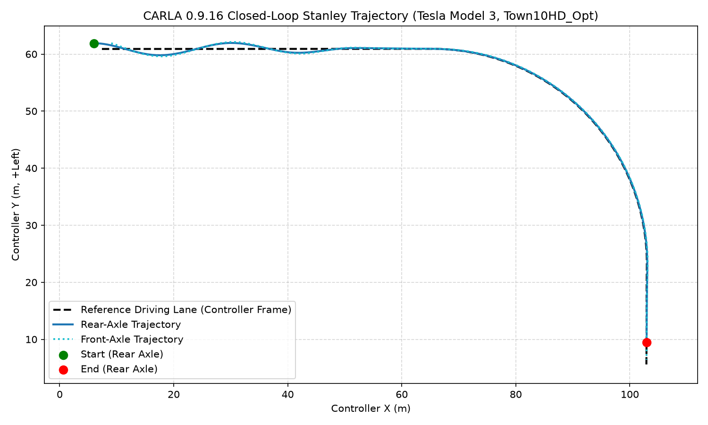
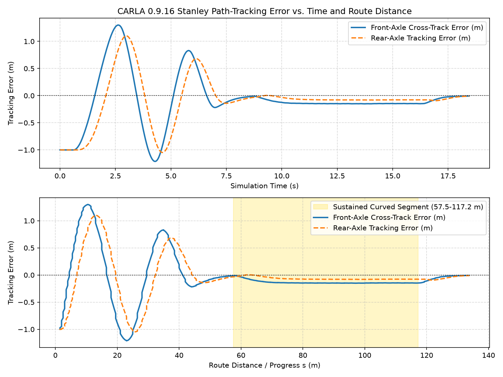

# Autonomous Vehicle Lane-Keeping: Controller Design and CARLA Validation

**Python · CARLA 0.9.16 · Stanley · Pure Pursuit · Augmented LQR · Constrained MPC · pytest**

A modular lateral path-tracking project progressing from an offline kinematic bicycle model to closed-loop validation of **five controllers** in CARLA. The project evaluates tracking accuracy, steering smoothness, actuator limits, speed sensitivity, and recovery from an initial lateral displacement.

> **Scope:** Simulation-based research and engineering validation—not a production-ready or safety-certified autonomous-driving system. Metrics below are reported from executed CARLA experiments and their telemetry summaries. Tests cover one reference route and limited conditions; they do not establish safety or robustness in arbitrary traffic and weather.

## Highlights

- **Five CARLA-integrated controllers:** Baseline lateral + heading feedback with curvature feedforward, Stanley, Pure Pursuit, augmented LQR, and constrained MPC.
- **15 successful speed-benchmark runs:** five controllers at **5, 8, and 10 m/s** target speeds.
- **One additional recovery experiment:** Stanley at **8 m/s**, starting **1 m left of the reference path**.
- **CARLA environment:** Tesla Model 3 in `Town10HD_Opt`, physics-derived wheelbase **3.0046 m**.
- **Common route:** **135.24 m**, including a sustained approximately 90° right-hand curve with minimum radius **37.66 m**.
- **Control constraints:** **±30°** applied front-wheel steering, **±20°/s** steering rate, **0.05 s** synchronous timestep.
- **Reported outcomes:** All 15 speed runs and the Stanley offset run completed the route, with **zero detected collisions** and **zero reported applied-steering constraint violations**.
- **Automated validation:** **264 tests passed** in the latest reported run (`python -m pytest tests -q`).


## Results: Five Controllers Across Three Speeds

**Test route:** `Town10HD_Opt`, spawn point **61**, lane 1, road sequence **10 → 0 → 3**, 277 waypoints spaced approximately 0.5 m. Segments: **57.50 m straight approach**, **60.22 m sustained curve**, **17.51 m straight exit**. Each run used the same vehicle blueprint, target route, 0.05 s control timestep, steering constraints, and longitudinal speed-controller design.

### Rear-axle tracking RMSE (m) — lower is better

| Controller | 5 m/s | 8 m/s | 10 m/s |
|---|---:|---:|---:|
| Stanley | 0.0344 | **0.0488** | 0.1089 |
| Constrained MPC | **0.0268** | 0.0664 | **0.0942** |
| Pure Pursuit | 0.0609 | 0.1460 | 0.2132 |
| Augmented LQR | 0.0837 | 0.1873 | 0.2583 |
| Baseline feedback + feedforward | 0.1604 | 0.2847 | 0.3540 |

### Front-axle cross-track RMSE (m) — lower is better

| Controller | 5 m/s | 8 m/s | 10 m/s |
|---|---:|---:|---:|
| Stanley | **0.0321** | **0.0915** | 0.1410 |
| Constrained MPC | 0.0940 | 0.1116 | **0.1283** |
| Pure Pursuit | 0.1222 | 0.1871 | 0.2437 |
| Augmented LQR | 0.1496 | 0.2315 | 0.2913 |
| Baseline feedback + feedforward | 0.2238 | 0.3276 | 0.3861 |

### Steering smoothness at 8 m/s

| Controller | Steering RMS (°) | Steering-rate RMS (°/s) | Maximum steering rate (°/s) |
|---|---:|---:|---:|
| Stanley | 3.3415 | 4.4192 | 14.8446 |
| Constrained MPC | 3.4207 | 2.6930 | 12.5964 |
| Pure Pursuit | **3.3156** | **1.5476** | **6.4024** |
| Augmented LQR | 3.3987 | 2.4933 | 15.2076 |
| Baseline feedback + feedforward | 3.4049 | 2.8547 | 20.0000 |

**Interpretation:** At 5 m/s, MPC had the lowest rear-axle RMSE while Stanley had the lowest front-axle RMSE. At 8 m/s, Stanley had the lowest error by both measures. At 10 m/s, MPC had the lowest RMSE by both measures, although Stanley had smaller **peak** rear- and front-axle deviations. Pure Pursuit had the lowest steering-rate RMS in the 8 m/s benchmark. All five controllers showed increasing overall tracking error as target speed increased on this route. These comparisons are specific to the tested tuning and road geometry; they are not universal rankings.

### Curved-road tracking and recovery

At 10 m/s, the sustained-curve rear-axle RMSE values were:

| Controller | Curved-segment rear RMSE (m) |
|---|---:|
| Stanley | 0.1587 |
| Constrained MPC | **0.1432** |
| Pure Pursuit | 0.2988 |
| Augmented LQR | 0.3925 |
| Baseline | 0.5270 |

The original 8 m/s zero-offset benchmark and the additional offset-recovery run use the same route but answer different questions: steady tracking versus transient recovery.

### Stanley +1 m initial lateral-offset experiment

A separate run started the Tesla approximately **1.0 m left** of the reference path, with aligned initial heading and **8 m/s** target speed. The controller was **not retuned** for recovery.

| Metric | Zero-offset Stanley, 8 m/s | +1 m offset Stanley, 8 m/s |
|---|---:|---:|
| Rear-axle RMSE | 0.0488 m | 0.4542 m |
| Front-axle CTE RMSE | 0.0915 m | 0.4896 m |
| Maximum absolute rear-axle error | 0.0942 m | 1.1020 m |
| Maximum absolute front-axle CTE | 0.1527 m | 1.3000 m |
| Maximum heading error | — | 15.67° |
| Maximum applied steering | 5.8144° | 20.0000° |
| Maximum applied steering rate | 14.8446°/s | 20.0000°/s |
| Route completed | Yes | Yes |
| Detected collisions | 0 | 0 |

The offset run showed **substantial oscillatory overshoot** during the initial straight-road recovery. The Stanley law generated a very large low-speed steering request (maximum reported requested magnitude **89.57°**), while the applied steering was bounded by angle and rate limits. As speed and heading error evolved, steering reversals lagged the requested correction. The rear-axle error changed sign repeatedly before decaying. By the sustained curve, rear-axle RMSE was **0.0688 m**, close to **0.0682 m** for the zero-offset run. The vehicle completed the route with no detected collision. **This is evidence of recovery in one simulation, not proof of robust stability.**

The 5 cm settling-time and recovery-distance metrics have **not yet been calculated** from the raw offset telemetry; they are intentionally not claimed here.





### MPC computation time

The CARLA MPC uses a **15-step horizon × 0.05 s = 0.75 s** with CVXPY and OSQP.

| Target speed | Mean OSQP solve (ms) | Max OSQP solve (ms) | Mean total control (ms) | Max total control (ms) | Reported solver failures | Observed deadline misses (>50 ms) |
|---|---:|---:|---:|---:|---:|---:|
| 5 m/s | 0.7611 | 2.2250 | 4.3762 | 8.4010 | 0 | 0 |
| 8 m/s | 0.2091 | 0.6578 | 4.0738 | 11.4903 | 0 | 0 |
| 10 m/s | 0.2147 | 0.5658 | 4.1621 | 7.5572 | 0 | 0 |

Desktop execution meeting an observed 50 ms budget is **not** a hard real-time guarantee on automotive hardware.

### 8 m/s telemetry visualizations


> **Plot note:** The `final_*` comparison images were generated from the original **8 m/s** telemetry. They are not multi-speed plots. The plotted signed errors may differ by controller convention; use absolute errors or consistently normalized signs when comparing traces.

## System Architecture

```text
CARLA map waypoints --> route extraction / curvature profile ----+
                                                               |
CARLA Tesla --> vehicle transforms / speed --> CARLA adapter ---+--> tracking state
                                                                      |
                                                  +-------------------+-------------------+
                                                  |                   |                   |
                                               Baseline           Stanley          Pure Pursuit
                                                  |                   |                   |
                                                  +--------- Augmented LQR / MPC --------+
                                                                      |
                                                        steering command / rate
                                                                      |
                                                steering limits + CARLA conversion
                                                                      |
                                                 throttle / brake + steering --> Tesla
                                                                      |
                                                 telemetry --> metrics --> plots/tests
```

`CarlaControllerAdapter` converts CARLA coordinates to the controller convention, uses live vehicle geometry to identify front- and rear-axle reference points, and converts desired front-wheel steering to normalized CARLA steering with the appropriate sign. The reported nominal maximum front-wheel steering angle is **70°**; effective response can vary with CARLA's speed-dependent steering behavior.

## Models and Controllers

### Offline vehicle and road model

The offline kinematic bicycle model uses rear-axle position $(x,y)$, yaw $\psi$, wheelbase $L=2.8\,\mathrm{m}$, speed $v$, and front-wheel steering $\delta$:

$$
\dot{x}=v\cos\psi,\qquad
\dot{y}=v\sin\psi,\qquad
\dot{\psi}=\frac{v}{L}\tan\delta.
$$

The offline sinusoidal road reference is $y_{\mathrm{ref}}(x)=A\sin(kx)$, with heading and curvature:

$$
\psi_{\mathrm{ref}}=\arctan(Ak\cos kx),\qquad
\kappa_{\mathrm{ref}}=\frac{-Ak^2\sin(kx)}{\left[1+(Ak\cos kx)^2\right]^{3/2}}.
$$

The CARLA integrations use the Tesla's measured wheelbase **3.0046 m**, not the offline default **2.8 m**. Offline simulation uses a **0.1 s** timestep; CARLA uses **0.05 s**.

### Coordinate and error conventions

In controller coordinates, global $X$ points along the initial forward road direction, $Y$ points left, positive yaw is counterclockwise, and positive steering turns left. For reference heading $\psi_{\mathrm{ref}}$, the local left normal is $\mathbf n=[-\sin\psi_{\mathrm{ref}},\cos\psi_{\mathrm{ref}}]^T$.

For the baseline, augmented LQR, and MPC, rear-axle lateral error is:

$$e_y=(\mathbf p_{\mathrm{rear}}-\mathbf p_{\mathrm{ref}})\cdot\mathbf n.$$

Stanley's front-axle control error uses the opposite displacement order:

$$e_{\mathrm{fa}}=(\mathbf p_{\mathrm{ref}}-\mathbf p_{\mathrm{front}})\cdot\mathbf n.$$

The Stanley rear-error telemetry also follows its controller-specific sign convention. RMSE and absolute error are sign-invariant, but signed traces require normalization for cross-controller comparison.

### Baseline feedback with curvature feedforward

The baseline reuses `PIDController` with $K_p=0.05$, $K_i=K_d=0$, and heading gain $K_\psi=0.8$:

$$\delta_{\mathrm{cmd}}=\arctan(L\kappa_{\mathrm{ref}})-K_pe_y-K_\psi e_\psi.$$

This is **proportional lateral + heading feedback**, not a fully tuned three-term PID. Angle and rate limits are applied after the command is computed.

### Stanley

Using the front-axle reference point $\mathbf p_{\mathrm{front}}=(x+L\cos\psi,\,y+L\sin\psi)$ and heading correction $\psi_e=\operatorname{wrap}(\psi_{\mathrm{ref}}-\psi)$:

$$\delta_{\mathrm{cmd}}=\psi_e+\operatorname{atan2}(k_s e_{\mathrm{fa}},v+\epsilon).$$

The tested gain was $k_s=1.5\,\mathrm{s}^{-1}$ with low-speed regularization $\epsilon=10^{-3}\,\mathrm{m/s}$. The +1 m recovery experiment illustrates that aggressive low-speed requests and external steering-rate limits can lead to an oscillatory transient.

### Pure Pursuit

Pure Pursuit selects a forward target by cumulative path arc length. From the rear axle, let $L_d$ be the actual Euclidean target distance and $\alpha$ the wrapped bearing error:

$$\delta_{\mathrm{cmd}}=\operatorname{atan2}(2L\sin\alpha,L_d).$$

The implementation supports fixed lookahead (10 m) and dynamic desired lookahead $L_{d,\mathrm{desired}}=3.0+0.5v$ (meters when $v$ is in m/s). Discrete waypoint selection makes actual Euclidean lookahead differ from desired lookahead.

### Augmented LQR

Uses state $z=[e_y,e_\psi,\delta]^T$ and steering-rate input $u=\dot\delta$. The original straight-road feedback is $u=-Kz$. The CARLA integration uses deviation steering $\delta-\delta_{\mathrm{ff}}$ and feedforward steering rate:

$$\delta_{\mathrm{ff}}=\arctan(L\kappa_{\mathrm{ref}}),\qquad
u=u_{\mathrm{feedback}}+\frac{d\delta_{\mathrm{ff}}}{dt}.$$

The gain is computed for each configured nominal speed; cost weights were not systematically retuned for the CARLA vehicle's dynamics.

### Constrained MPC

MPC optimizes steering rate over a receding horizon with state $z=[e_y,e_\psi,\delta]^T$:

$$
\min_{u_0,\ldots,u_{N-1}}
\sum_{k=0}^{N-1}(z_k^TQz_k+u_k^TRu_k)+z_N^TQ_fz_N
$$

subject to discrete tracking dynamics and hard bounds $|\delta_k|\le30^\circ$, $|u_k|\le20^\circ/\mathrm{s}$. Cost weights: $Q=\operatorname{diag}(10,5,1)$, $R=1$, $Q_f=\operatorname{diag}(20,10,2)$. The solver uses CVXPY + OSQP with warm starting and bounded fallback behavior on solver failure. Offline prediction uses **15 × 0.1 s = 1.5 s**; CARLA uses **15 × 0.05 s = 0.75 s**, with the prediction model constructed for the actual timestep and nominal speed.

## Development Milestones

| Phase | Completed work |
|---|---|
| 1–6 | Kinematic vehicle model, baseline feedback, LQR, augmented LQR, offline comparison and tests |
| 7 | Curved-road position, heading, and curvature reference |
| 8 | Stanley path tracking |
| 9 | Pure Pursuit lookahead tracking |
| 10 | Constrained MPC |
| 11 | CARLA adapter, waypoint route, and all five controller integrations |
| 12A | Unified benchmark metrics and consistency checks |
| 12B | Five controllers at 5, 8, and 10 m/s; Stanley +1 m offset recovery |
| 12D | Comparison charts and telemetry analysis |
| 12E | README and technical documentation |
| 12F | CARLA demonstration recordings |

Additional disturbance/noise testing and a fully parameterized multi-scenario harness were proposed but **not claimed complete**.

## Setup and Reproduction

### Offline Python simulations

From the repository root, install the project's dependencies in a compatible environment:

```powershell
python -m pip install -r requirements.txt
python src/compare_controllers.py
python src/curved_road_simulation.py
python src/stanley_simulation.py
python src/pure_pursuit_simulation.py
python src/mpc_simulation.py
python -m pytest tests -q
```

### CARLA 0.9.16 on Windows

1. Launch the CARLA 0.9.16 simulator and load `Town10HD_Opt` on `127.0.0.1:2000`.
2. Activate the existing Python 3.12 CARLA virtual environment and ensure the CARLA Python API and project dependencies are installed.
3. Run one controller client at a time; use unique `file_prefix` values to preserve existing results.

```powershell
.\.venv-carla\Scripts\Activate.ps1
python src/carla_integration/baseline_carla.py
python src/carla_integration/stanley_carla.py
python src/carla_integration/pure_pursuit_carla.py
python src/carla_integration/augmented_lqr_carla.py
python src/carla_integration/mpc_carla.py
```

These default entry points reproduce each script's configured default scenario. For speed sweeps, call the exported runner functions with explicit `target_speed_mps` and unique prefixes. Example:

```powershell
python -c "import sys; from pathlib import Path; sys.path.insert(0,'src'); from carla_integration import stanley_carla; s=stanley_carla.run_stanley_carla_test(target_speed_mps=10.0, file_prefix='phase12b_stanley_10ms', results_dir=Path('results')); print(s)"
```

The Stanley +1 m offset integration uses `initial_lateral_offset_m=1.0` and must verify the initial rear-axle position and spawn clearance before driving. The other four runner interfaces were **not** extended for initial-offset tests in the reported work.

### Unified benchmark and plotting

```powershell
# Recalculate the original five-controller 8 m/s metrics from saved CSVs
python src/carla_integration/unified_benchmark.py

# Regenerate the original 8 m/s comparison images
python src/final_controller_analysis.py
python src/final_telemetry_comparison.py
```

**Caution:** The existing unified benchmark's `--live` cleanup implementation may remove all world vehicles and sensors, including actors not created by this project. Do not use `--live` in a shared CARLA session without narrowing cleanup to benchmark-owned actors. Its offline evaluation of historical CSVs also assumes successful termination/collision-free status unless separately verified against saved run summaries.

### Repository Guide

```text
src/
  vehicle.py
  road.py
  controllers/
    pid_controller.py
    lqr_controller.py
    augmented_lqr_controller.py
    stanley_controller.py
    pure_pursuit_controller.py
    mpc_controller.py
  carla_integration/
    carla_adapter.py
    baseline_carla.py
    stanley_carla.py
    pure_pursuit_carla.py
    augmented_lqr_carla.py
    mpc_carla.py
    unified_benchmark.py
  final_controller_analysis.py
  final_telemetry_comparison.py
tests/
results/
README.md
requirements.txt
```

## Testing and Reproducibility

The latest user-reported complete suite was:

```text
264 passed in 42.39s
```

The tests include mock-based geometry, coordinate/sign conversion, steering constraints, route continuity, controller integration, cleanup, and benchmark schema/metric checks. Passing these tests does not validate all dynamic or traffic scenarios. The multi-speed results above come from separate controller-specific CARLA runs with shared nominal conditions; a single parameterized multi-scenario runner and independent audit of all raw telemetry remain optional improvements.

## Known Limitations

- **Single route:** The speed comparison uses one 135.24 m route and one vehicle blueprint; broader generalization requires additional maps, curves, surfaces, and conditions.
- **Model mismatch:** Offline controllers rely on simplified bicycle dynamics; CARLA includes more detailed tire and vehicle behavior and speed-dependent steering response.
- **Steering mapping:** Nominal front-wheel angle-to-CARLA steering conversion is not a complete steering actuator model.
- **Different control reference points and sign conventions:** Stanley uses front-axle error; the others principally use rear-axle error. Both metrics are reported to improve fairness, but signed telemetry must be normalized for overlays.
- **Waypoint representation:** Discrete waypoint selection and curvature differentiation can cause quantization and steering ripple; some integrations smooth the curvature profile.
- **Initial tuning:** Baseline, LQR, Pure Pursuit, and MPC parameters were not systematically optimized across all scenarios.
- **Recovery transient:** The untuned Stanley +1 m experiment produced oscillatory overshoot and reached the 20°/s steering-rate limit. Recovery time and distance are not yet formally quantified.
- **MPC prediction and timing:** Linearized constant-nominal-speed prediction and desktop solver timing are not production real-time guarantees.
- **No perception or highway ADAS:** ACC, radar-based blind-spot detection, and lane-change assistance are reserved for a separate follow-on project.

## Project Status and Future Work

**Portfolio scope: complete.** Five controllers were implemented, integrated into CARLA, tested at three speeds, and documented with telemetry, comparison plots, automated tests, and demonstration recordings. The offset test adds a documented transient-recovery limitation.

**Optional follow-up work:** independent telemetry audit, additional disturbance/noise tests, a shared scenario-configuration interface for all five controllers, measured settling-time/recovery-distance analysis, and consolidated demonstration-video editing. None is necessary to claim the scoped simulation portfolio deliverable, and none should be mistaken for production safety validation.

**Next separate project:** Radar-based Adaptive Cruise Control, Blind Spot Detection, and Lane Change Assistance in CARLA.
